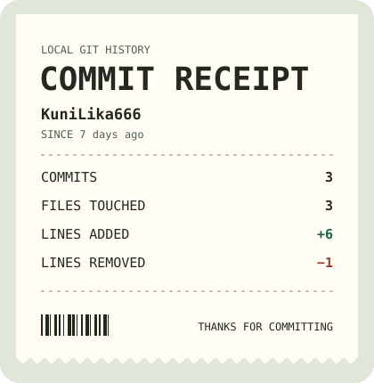
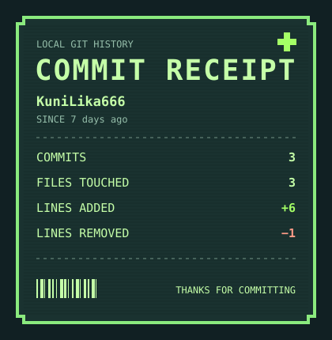
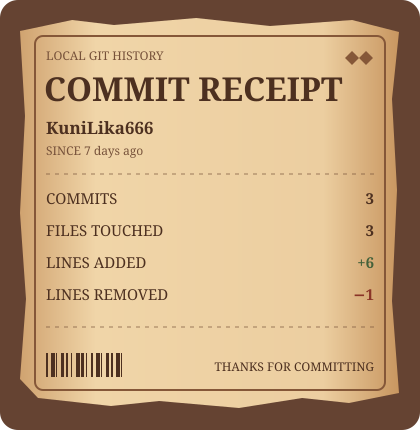
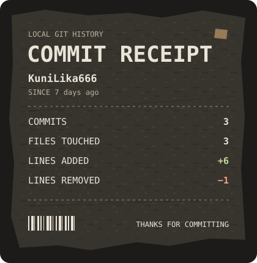
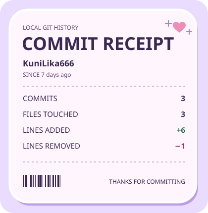

# git-receipt — чек из коммитов

поработали? вот чек и покажет) он собирает из истории Git коммиты, файлы и строки, которые добавили или убрали.

**[скачать для Windows](https://github.com/KuniLika69/git-receipt/releases/latest/download/git-receipt-windows-x64.zip)** · **[скачать Python-версию](https://github.com/KuniLika69/git-receipt/releases/latest/download/git-receipt-python.zip)**

## вот какие чеки получаются

| обычный | пиксельный | старинный |
| :---: | :---: | :---: |
| [](example.svg) | [](examples/pixel.svg) | [](examples/vintage.svg) |
| `classic` | `pixel` | `vintage` |

| потрёпанный | стикер |
| :---: | :---: |
| [](examples/grunge.svg) | [](examples/sticker.svg) |
| `grunge` | `sticker` |

## как запустить

нужен Git 2.37 или новее. все данные берутся из репозитория на твоём устройстве.

**Windows x64.** распакуй ZIP, открой PowerShell в папке с `git-receipt.exe` и подставь путь к своему репо. Python для этой версии не нужен.

```powershell
.\git-receipt.exe "C:\Projects\my-project"
```

**Python-версия.** распакуй ZIP и запусти скрипт из этой папки. нужен Python 3.9+, дополнительных пакетов нет.

```powershell
python git_receipt.py "C:\Projects\my-project"
```

на macOS и Linux можно запустить так:

```bash
python3 git_receipt.py "/путь/к/репо"
```

чек за последние 7 дней сохранится в `receipt.svg` в текущей папке. открой его в браузере. если запускаешь программу из нужного репо, путь к нему можно опустить.

хочешь другую бумажку или период? `--style` меняет вид чека, `--since` — дату начала, `--output` — имя файла. например, вот стикер за месяц:

```powershell
.\git-receipt.exe "C:\Projects\my-project" --style sticker --since "30 days ago" --output month.svg
```

те же параметры работают и у `git_receipt.py`.

## что попадает в чек

- коммиты из истории текущего `HEAD` за выбранный период. коммиты слияния пропускаются.
- сколько разных путей к файлам поменялось. переименование считается двумя путями.
- сколько строк добавили и удалили. бинарные файлы идут в счётчик файлов.

в репо должен быть хотя бы один коммит. если за выбранный период коммитов не было, чек покажет нули.

## автор

сделала **KuniLika666**. [мой Twitch](https://www.twitch.tv/kunilika666)

если чек пригодился, можно поставить звёздочку сверху. мне будет приятно 💜
